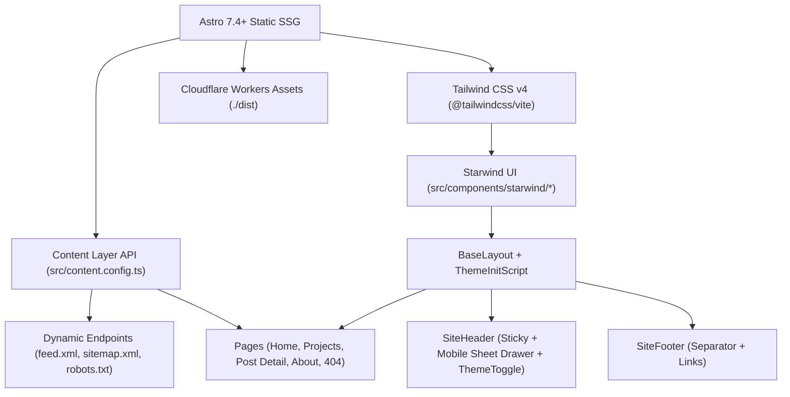

# Astro 7 Upgrade & Starwind UI Mobile-First Redesign Plan

## Goal Description

Upgrade Francisco Gonzalez IV's personal portfolio from **Astro 5.4.2 + Bootstrap 5.3 + Sass** to **Astro 7.4+ + Tailwind CSS v4 + Starwind UI**, performing a generous, mobile-first visual restyling while preserving 100% of the existing copy, projects, routes, SEO/RSS/sitemap endpoints, and Cloudflare Workers deployment pipeline.

### Current State Audit
- **Framework**: `astro@^5.4.2`, `@astrojs/rss@^4.0.11`, Node `v22.14.0` locally (meets Astro 7's `>=22.12.0` requirement).
- **Styling**: Bootstrap `^5.3.3`, Sass `^1.85.1`, Bootstrap JS bundle, plus 12 legacy Eleventy-era CSS/SCSS files in `src/styles/`.
- **Content Collections**: Legacy Astro 4/5 API (`src/content/config.ts` with `type: 'content'`, `post.slug`, `post.render()`, `z` from `astro:content`).
- **Known UX / Mobile & Markup Gaps Found**:
  - `src/pages/projects.astro` hides project screenshots on mobile/tablet (`d-none d-lg-block`).
  - `src/layouts/BaseLayout.astro` renders the navbar site title as `<h1>`, creating duplicate `<h1>` tags on every page, and `PostLayout.astro` nests a second `<main>` inside `BaseLayout`'s `<main>`.
  - `PostLayout.astro` receives `url` and `tags` props from frontmatter but never displays them.
  - `src/content/blog/circle-square-hair-salon.md` embeds raw Bootstrap classes (`img-fluid card-img col-6 mx-auto d-block`) on an inline GIF.
  - `src/pages/about.astro` ends paragraph 3 with unlinked text (`"Take a look here"`).
  - `src/data/site.json` references `/images/default-social-image.webp` (missing from `public/images/`) and a placeholder `"twitterHandle": "author_handle"`.
  - Project screenshots have mixed aspect ratios (`16:9` vs `1.14:1`) and multi-megapixel PNG dimensions (`4468×2640`, `3840×2264`), while `.project-card` forces a `640px` min-height on desktop.

---

## User Review Required

> [!IMPORTANT]
> **Breaking Changes in Astro 5 → Astro 7.4+**:
> - **Content Layer Migration**: Astro 6 removed legacy `src/content/config.ts` support. We will migrate to `src/content.config.ts` using the `glob()` loader (`astro/loaders`), `z` from `astro/zod`, standalone `render(post)` from `astro:content`, and `post.id` in place of `post.slug`. All existing `/posts/<slug>/` URLs remain identical.
> - **Bootstrap & Sass Removal**: Replacing Bootstrap 5 + Sass with Tailwind CSS v4 (`@tailwindcss/vite`) and Starwind UI removes the Bootstrap JS bundle and all 12 legacy CSS/SCSS files in `src/styles/`.
> - **Astro 7 Strict HTML Compiler**: Fixing nested `<main>` tags and duplicate `<h1>` semantics ensures strict template compliance and better accessibility.

---

## Approved Design Decisions

- **Visual Theme & Accent Direction**: **Option B — Stone & Pine/Teal** (warm neutral stone light/dark surfaces with deep evergreen/teal accent nodding to Richmond/outdoors and `#399f7a`, paired with IBM Plex Sans + IBM Plex Mono).
- **Light / Dark Mode**: Included via Starwind `ThemeToggle` + `ThemeInitScript` (system preference default, flicker-free manual toggle).
- **Contact Button**: Excluded (keep `contact@franciscogonzaleziv.com` out of the UI).
- **Included Polish**:
  - Responsive image optimization for large project screenshots via Astro `<Image />` / WebP.
  - Link `"Take a look here"` on the About page to `/projects/`.
  - Surface frontmatter `url` (`"Visit Live Site ↗"`) and `tags` on project detail pages.
  - Clean up placeholder `twitterHandle` and missing `defaultSocialImage` in `site.json`, passing project screenshots for Open Graph images.
  - Lightweight tag filter pills on `/projects/`.
  - Ignore leftover template `screenshot.png`.

---

## Architecture & Design Overview



### Mobile-First Layout Strategy
- **Navigation**: Sticky glassmorphic top bar (`h-16`) with brand link on the left, `ThemeToggle` + 44×44px `Sheet` drawer trigger on mobile (`< md`), transitioning to inline links + `ThemeToggle` on desktop (`>= md`).
- **Touch Targets & Ergonomics**: Minimum `44px` interactive targets on mobile buttons, drawer links, and prev/next pagination cards; comfortable horizontal padding (`px-4 sm:px-6 lg:px-8`) inside a focused `max-w-5xl` container.
- **Consistent Media Framing**: Project preview cards use uniform `aspect-[16/10]` containers with `object-cover object-top` so both `16:9` and `1.14:1` screenshots align cleanly on mobile and desktop grids; detail pages show full uncropped screenshots inside an elevated browser-style frame.

---

## Proposed Changes

### Phase 1: Astro 7 Upgrade & Tooling Configuration

Upgrade core Astro packages, remove Bootstrap/Sass, configure TypeScript path aliases, and wire Tailwind CSS v4 + Starwind UI.

- **[MODIFY] `package.json`**:
  - Upgrade `astro` to `^7.4.13` and `@astrojs/rss` to `^4.0.19`.
  - Remove `bootstrap` and `sass`.
  - Install Tailwind CSS v4 & Starwind UI runtime/utilities via `npx starwind@latest init --framework astro` (`tailwindcss@^4.3.5`, `@tailwindcss/vite@^4.3.5`, `@starwind-ui/astro@^1.5.0`, `tw-animate-css`, `@tailwindcss/forms`, `tailwind-merge`, `tailwind-variants`, `@tabler/icons`).
- **[NEW] `tsconfig.json`**:
  - Extend `astro/tsconfigs/strict` with `baseUrl: "."` and `paths: { "@/*": ["./src/*"] }`.
- **[MODIFY] `astro.config.mjs`**:
  - Add `@tailwindcss/vite` to `vite.plugins`, preserving `site`, `output: "static"`, and `trailingSlash: "always"`.
- **[NEW] `starwind.config.json`**:
  - Generated via Starwind CLI, configured for Astro + `src/styles/starwind.css` + `src/components/starwind`.

---

### Phase 2: Content Layer API Migration (Astro 6/7)

Migrate content collections out of the removed Astro 5 legacy mode while preserving every frontmatter field and URL slug.

- **[DELETE] `src/content/config.ts`** → **[NEW] `src/content.config.ts`**:
  ```ts
  import { defineCollection } from "astro:content";
  import { glob } from "astro/loaders";
  import { z } from "astro/zod";

  const blog = defineCollection({
    loader: glob({ pattern: "**/*.md", base: "./src/content/blog" }),
    schema: z.object({
      title: z.string(),
      date: z.coerce.date(),
      tags: z.array(z.string()).default([]),
      description: z.string().default(""),
      screen: z.string().optional(),
      url: z.string().url().optional(),
      order: z.number().optional(),
    }),
  });

  export const collections = { blog };
  ```
- **[MODIFY] `src/pages/posts/[...slug].astro`**:
  - Replace `post.slug` → `post.id` and `await post.render()` → `await render(post)` (from `astro:content`).
- **[MODIFY] `src/pages/feed.xml.ts` & `src/pages/sitemap.xml.ts`**:
  - Replace `post.slug` → `post.id` and add `APIContext` typing.
- **[MODIFY] `src/content/blog/circle-square-hair-salon.md`**:
  - Replace Bootstrap-specific classes on line 12 (`class="img-fluid card-img col-6 mx-auto d-block"`) with standard Markdown image syntax (``).

---

### Phase 3: Starwind UI Component Library & Design System

- **[NEW] Starwind Components (`src/components/starwind/`)**:
  - Install via `npx starwind@latest add`: `button`, `card`, `badge`, `sheet`, `separator`, `breadcrumb`, `theme-toggle`.
- **[NEW] `src/styles/starwind.css`**:
  - Tailwind v4 entrypoint (`@import "tailwindcss";`, `@import "tw-animate-css";`, `@plugin "@tailwindcss/forms";`), light/dark semantic OKLCH theme variables, IBM Plex Sans + IBM Plex Mono font tokens, and `@layer components` `.prose-portfolio` typography rules.
- **[DELETE] Legacy Stylesheets (`src/styles/`)**:
  - Remove `main.scss`, `footer.scss`, `global.css`, `header.css`, `hero.css`, `post.css`, `post-list.css`, `about.css`, `not-found.css`, `typography.css`, `variable.css`, `prism-theme.css`.

---

### Phase 4: Shared Components & Layouts

- **[NEW] `src/components/SiteHeader.astro`**:
  - Sticky translucent header (`border-b bg-background/85 backdrop-blur-md`).
  - Brand link (`<a>`, fixing duplicate `<h1>`), desktop nav links + `ThemeToggle`, mobile `ThemeToggle` + Starwind `Sheet` drawer.
- **[NEW] `src/components/SiteFooter.astro`**:
  - `Separator` + responsive copyright and accessible `GitHub` / `RSS` / `socialLinks` links.
- **[NEW] `src/components/ProjectCard.astro`**:
  - Reusable Starwind `Card` with `variant="grid"` (Home) and `variant="list"` (Projects — mobile-stacked vertical card transitioning to horizontal split on desktop, showing screenshots on all screen sizes).
- **[MODIFY] `src/layouts/BaseLayout.astro`**:
  - Import `@/styles/starwind.css` + `ThemeInitScript`, load IBM Plex Sans (`400;500;600;700`) and IBM Plex Mono, keep meta/OG/GA tags, remove Bootstrap JS bundle, wire `SiteHeader` and `SiteFooter`.
- **[MODIFY] `src/layouts/HomeLayout.astro`**:
  - Mobile-first Hero with eyebrow badge, styled intro slot, CTA buttons, `Separator`, and responsive 1→2 column `ProjectCard` grid.
- **[MODIFY] `src/layouts/PostLayout.astro`**:
  - Remove nested `<main>`, add Starwind `Breadcrumb`, project metadata header (`date`, tag `Badge`s, `"Visit Live Site ↗"` `Button`), full uncropped framed screenshot, readable `.prose-portfolio` body, and `Card`-styled Previous/Next pagination.

---

### Phase 5: Pages & Documentation

- **[MODIFY] `src/pages/index.astro`**: Preserve exact hero copy and `order`-based sorting.
- **[MODIFY] `src/pages/projects.astro`**: Responsive stack of `ProjectCard` (`variant="list"`), optionally with tag filter pills.
- **[MODIFY] `src/pages/about.astro`**: Mobile-first stacked editorial layout → 2-column desktop layout, framed portrait, exact bio paragraphs preserved, link polish on `UNOS` and `"Take a look here"`.
- **[MODIFY] `src/pages/404.astro`**: Centered Starwind `Card` empty state with `Go Home` and `View Projects` buttons.
- **[MODIFY] `AGENTS.md`**: Update architecture, tech stack, and conventions for Astro 7 + Tailwind v4 + Starwind UI.

---

## Verification Plan

### Automated Verification
1. `npx astro check` — Verify zero TypeScript or Astro template compiler errors.
2. `npm run build` — Verify clean Astro 7 production build and all generated static routes (`index.html`, `about/`, `projects/`, `404.html`, all 4 `/posts/<slug>/` pages, `feed.xml`, `sitemap.xml`, `robots.txt`).
3. `npm run preview:worker` — Verify Cloudflare Workers asset routing, trailing slashes, and `404-page` behavior.

### Visual & Mobile-First Browser Verification
1. Inspect all pages at `375×812` (mobile), `768×1024` (tablet), and `1280×800` (desktop) confirming zero horizontal overflow.
2. Test mobile `Sheet` drawer open/close, keyboard Escape, and route navigation.
3. Test `ThemeToggle` light/dark switching and reload persistence (no flash of unstyled theme).
4. Verify all project images, the Circle Square GIF, external links, and zero browser console errors.
